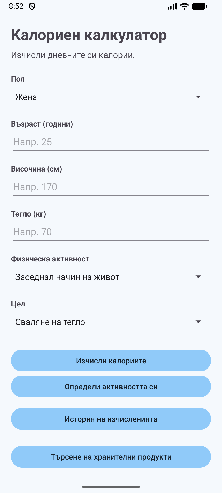
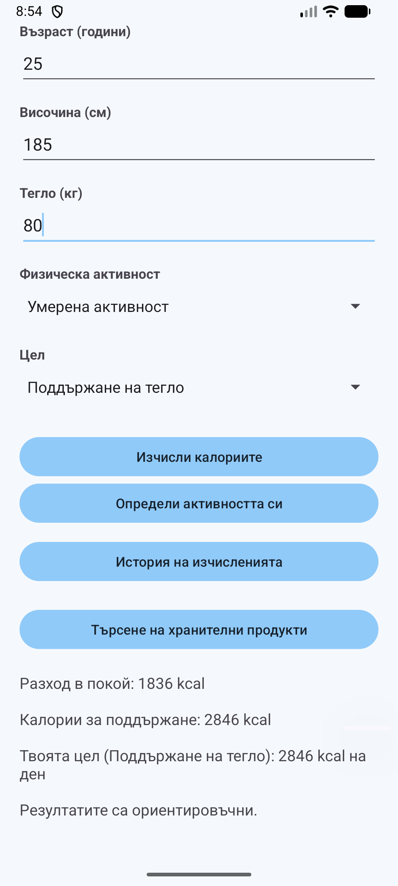
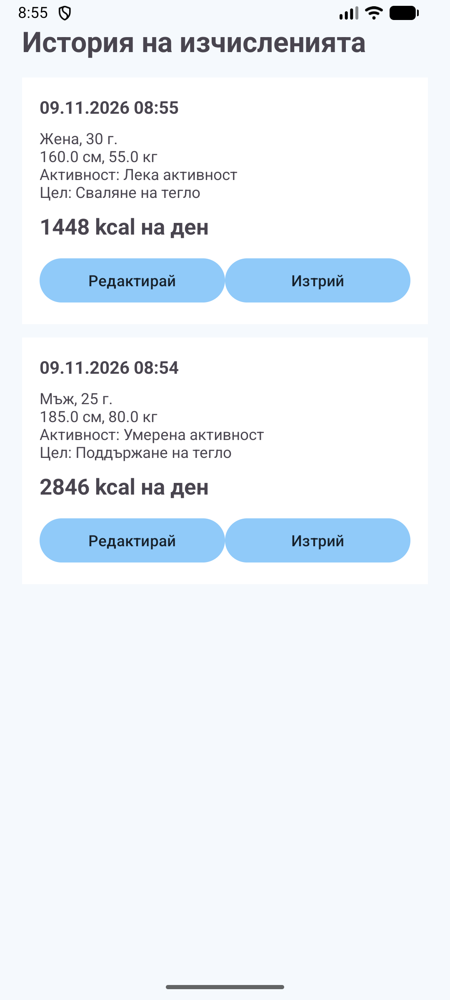
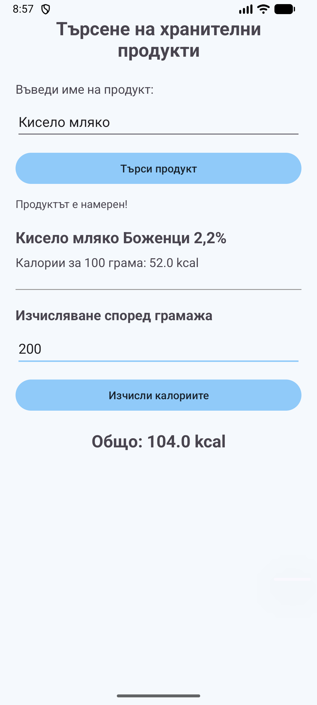

# Calorie Calculator

This is my project for the Mobile Applications course.

The application helps users calculate how many calories they need each day. It also has a food search option and saves previous calculations.

## 1. Project Idea

I wanted to make a simple application that can help people keep track of their daily calorie needs.

Users can enter their personal information, choose their activity level and select their goal.

## 2. How It Works

First, the user enters their gender, age, height and weight.

Then the user chooses their activity level and goal.

The application uses the Mifflin-St Jeor formula to calculate the basic calorie needs. It also takes physical activity into account.

There are three goals: losing weight, maintaining weight and gaining weight.

The application shows the estimated daily calories and saves the result in the history.

Users can also search for food products and calculate their calories based on the quantity in grams.

## 3. Architecture

The application is written in Kotlin.

It uses MVVM and the Repository pattern.

Room is used to save the calculation history. ViewModel and Repository are used to manage the saved calculations.

The calorie formulas are in a separate class called CalorieCalculator.

## 4. User Flow

1. Open the application.
2. Enter personal information.
3. Choose an activity level.
4. Select a goal.
5. Press the calculate button.
6. View the result and open the history.

The user can also open the food search screen, find a product and calculate its calories.

## 5. How to Run

1. Download or clone the project from GitHub.
2. Open it in Android Studio.
3. Wait for Gradle Sync to finish.
4. Start an Android emulator or connect an Android phone.
5. Press Run.

Minimum Android version: API 24.

## 6. Test Accounts

No account or registration is needed.

## 7. Screenshots

### Main Screen

### Calculation Result

### Calculation History

### Food Search

## 8. APK

The APK file will be available here:

[Download APK](apk/app-release.apk)

## 9. Technologies Used

Kotlin

Android Studio

XML

Room Database

ViewModel

Repository

RecyclerView

REST API

Open Food Facts

JUnit

Espresso

## 10. Tests

The project has 6 Unit tests for the calorie calculations.

It also has 1 Espresso test for checking the food search screen.

All 7 tests passed during development.

## 11. Author

Mobile Applications course project.

GitHub repository: [MobileApps2026-2401321031](https://github.com/Sheniz31/MobileApps2026-2401321031)